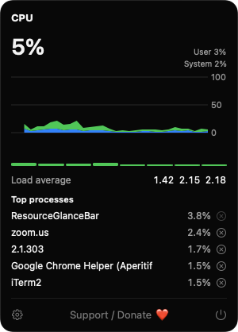
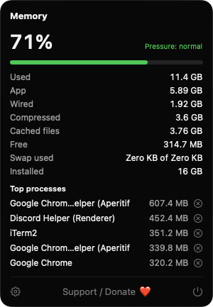
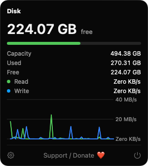
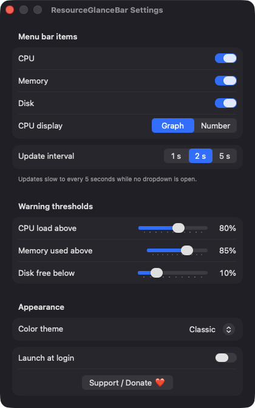

# ResourceGlanceBar

**🌐 Website:** [turhe123.github.io/resource-glance-bar](https://turhe123.github.io/resource-glance-bar/)

CPU load, memory pressure and disk space as tiny live meters in the menu bar with a detailed dropdown.


## Why

ResourceGlanceBar is a free, open-source, 100% native, backend-free alternative to paid utilities in the *System Monitoring* category. It was inspired by the tidy, glanceable readouts of iStat Menus ($11.99 one-time), and focuses on three resources: CPU, memory and disk. There is no server, no account and no telemetry. It reads system counters locally and nothing leaves your Mac.

## Features

- **Up to three independent menu bar items** — CPU, Memory and Disk, each toggled separately in Settings (the last visible item can't be hidden, so you can always get back to the app).
- **CPU**
  - Menu bar shows a tiny graph of the last 20 samples, or a percentage.
  - Dropdown: total load split into user and system, a history chart, per-core bars, load average, and the five busiest processes.
- **Memory**
  - Menu bar shows used percentage with a status dot driven by kernel memory pressure and your threshold.
  - Dropdown: used, app, wired, compressed, cached files, free, swap used and installed memory, plus the five processes using the most memory.
- **Disk**
  - Menu bar shows free space on the startup volume.
  - Dropdown: capacity, used and free, a usage meter, and read/write throughput with a chart.
- **Quit Process** button next to each listed process, with an inline confirmation. It sends a terminate request (SIGTERM). It is disabled for root-owned processes and for the app itself.
- **Settings:** update interval (1, 2 or 5 s), warning thresholds for CPU, memory and disk, three color themes (Classic, Ocean, Mono), and launch at login.
- **Light on resources:** updates slow to every 5 seconds while no dropdown is open, and samples after a long gap (such as waking from sleep) are discarded.
- **Support / Donate ❤️** button in the Settings window and in each dropdown.
- Universal binary (Apple silicon and Intel), no Dock icon.

## Screenshots

<p align="center"></p>

<p align="center"><em>The CPU dropdown shows total load split into user and system time, a live history chart, per-core bars, load average and the busiest processes.</em></p>

<p align="center"></p>

<p align="center"><em>The Memory dropdown shows used percentage, kernel memory pressure, a full breakdown of app, wired, compressed and cached memory, and the top memory users.</em></p>

<p align="center"></p>

<p align="center"><em>The Disk dropdown shows free space on the startup volume, capacity and usage, plus a live read/write throughput chart.</em></p>

<p align="center"></p>

<p align="center"><em>Settings let you choose which menu bar items to show, the update interval, warning thresholds, a color theme and launch at login.</em></p>

## Install

1. Download `ResourceGlanceBar-macOS.zip` from the [latest release](https://github.com/turhe123/resource-glance-bar/releases/latest).
2. Unzip it and move `ResourceGlanceBar.app` to `/Applications`.
3. Because the app is open source and not notarized, clear the quarantine attribute:

   ```bash
   xattr -cr /Applications/ResourceGlanceBar.app
   ```

4. The first time, right-click the app and choose **Open**.

## Build from source

Requires macOS 14+ and Xcode with Swift 5.9+.

```bash
brew install xcodegen
xcodegen generate
xcodebuild -project ResourceGlanceBar.xcodeproj -scheme ResourceGlanceBar -configuration Release -derivedDataPath ./build build
```

The app is produced at `build/Build/Products/Release/ResourceGlanceBar.app`.

## Permissions

ResourceGlanceBar doesn't request Accessibility, Screen Recording, Microphone, Camera, Contacts or any other privacy permission, and it isn't sandboxed. It uses only standard system APIs:

- Mach, `sysctl` and `getloadavg` for CPU and memory statistics.
- Volume capacity values from Foundation and IOKit block-storage statistics for disk space and throughput.
- `libproc` for the process lists. Only processes your user can read are shown; others are skipped silently.
- `kill(SIGTERM)` only when you confirm **Quit Process** on one of your own processes.
- `ServiceManagement` to register a login item, only if you turn on **Launch at login**. macOS may show its own login-item notice.

## Support ❤️

ResourceGlanceBar is free and always will be. If it's useful to you, you can help keep the work going:

[Support Or (Leo) Davidai ❤️ on Ko-fi](https://ko-fi.com/leodavidai)

## License

MIT © Or Davidai Bachar
